<div align="center">


# Qubrynt

**Track your habits, tasks, learning, money and mood in one calm place, and see how you improve over weeks, months and years.**

[Live demo](#) · [Backend repo](https://github.com/quickbuildsdev/qubrynt_backend) · [Report a bug](https://github.com/quickbuildsdev/qubrynt_frontend/issues)

</div>

<p align="center">
  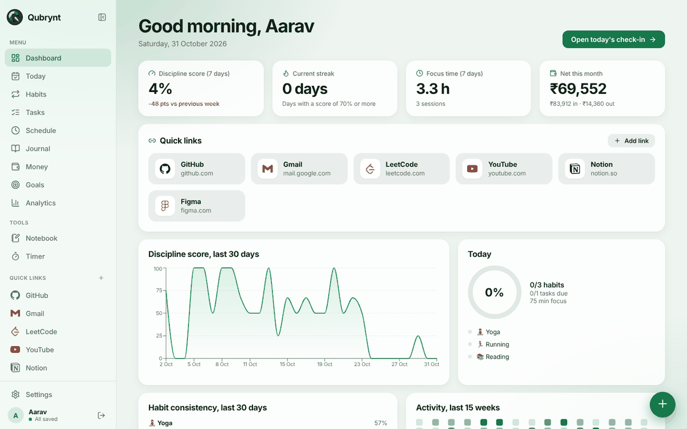
  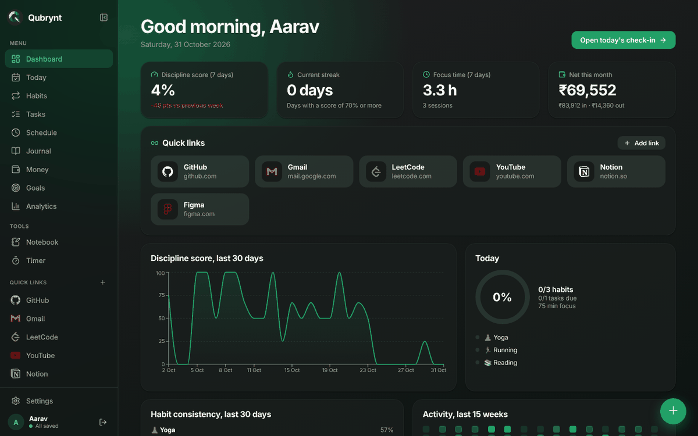
</p>

---

## Contents
- [What is Qubrynt?](#what-is-qubrynt)
- [How it helps you](#how-it-helps-you)
- [Features](#features)
- [For users: getting started](#for-users-getting-started)
- [For developers](#for-developers)
  - [Tech stack](#tech-stack)
  - [How it fits together](#how-it-fits-together)
  - [Code structure](#code-structure)
  - [Run locally](#run-locally)
  - [Deploy](#deploy)
  - [Troubleshooting](#troubleshooting)

---

## What is Qubrynt?

Qubrynt is a personal discipline tracker. Every day you tick off habits, finish tasks, run focus sessions, write what you learned and note your mood and spending. Qubrynt turns all of that into a **discipline score**, streaks and reports, so you can see what is really working instead of guessing.

Your data is saved to your own account in a database, so it is there on your phone, laptop and any other device.

## How it helps you

| You want to... | Qubrynt gives you... |
|---|---|
| Build a daily routine | Habits (done / not done, or a number such as 5 km or 20 pages) with streaks |
| Stop forgetting things | Tasks with due dates and priorities, plus a timed schedule for your day |
| Stay focused | A built in timer that logs focus sessions automatically |
| See what you achieved in the last 3 months | Analytics for a week, month, 3 months, year or custom range, with plain language insights |
| Remember what you learned | A journal for learnings, achievements and mood |
| Keep notes organised | A Notebook where books hold pages, like a real notebook |
| Understand your money | Income and expenses in ₹ with your own categories |
| Reach your tools quickly | Quick links with real brand icons (GitHub, Gmail, YouTube...) |
| Keep long term goals in sight | Goals with progress |

> Example: after 3 months you can open Analytics and read "You are most consistent on Tuesdays and weakest on Wednesdays", "Strongest habit: Yoga (66%)", or "Running is up 1153% vs the previous period".

## Features

### Dashboard
Your discipline score, streak, focus time and money this month, your quick links, a 30 day trend and a 15 week activity heatmap.

<p align="center"></p>

### Today
A daily check-in: habits, tasks due, today's schedule, a focus timer and a mood picker. Go back to any earlier day to fill in what you missed.

<p align="center">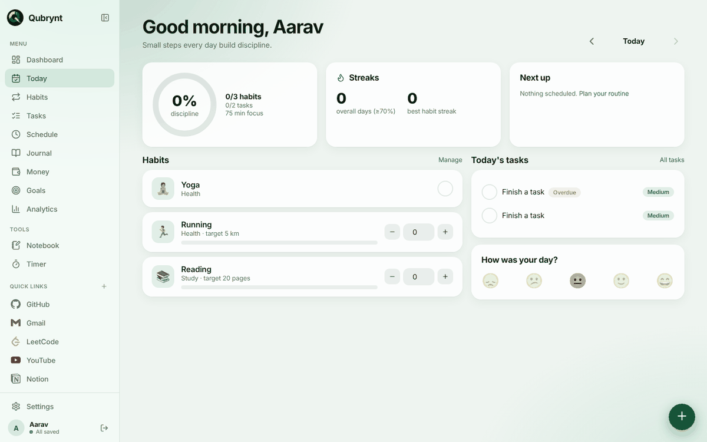</p>

### Habits
Add your own habits or start from a quick add list. Choose the days of the week, set a daily target and group them by category.

<p align="center">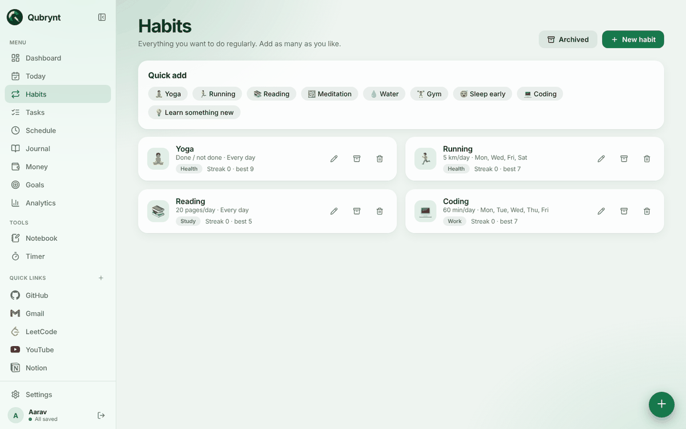</p>

### Notebook: books and pages
A book is a folder and pages are the files inside it. Press **New book**, then the **+** on a book to add pages. Search across everything, pin important pages, and everything saves as you type on ruled paper.

<p align="center">
  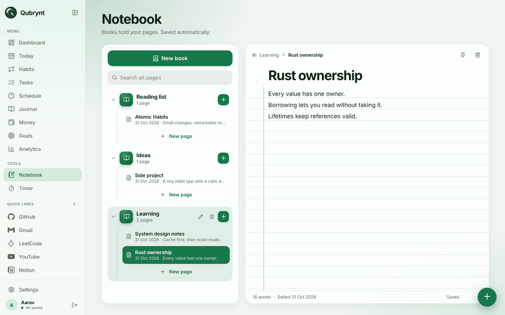
  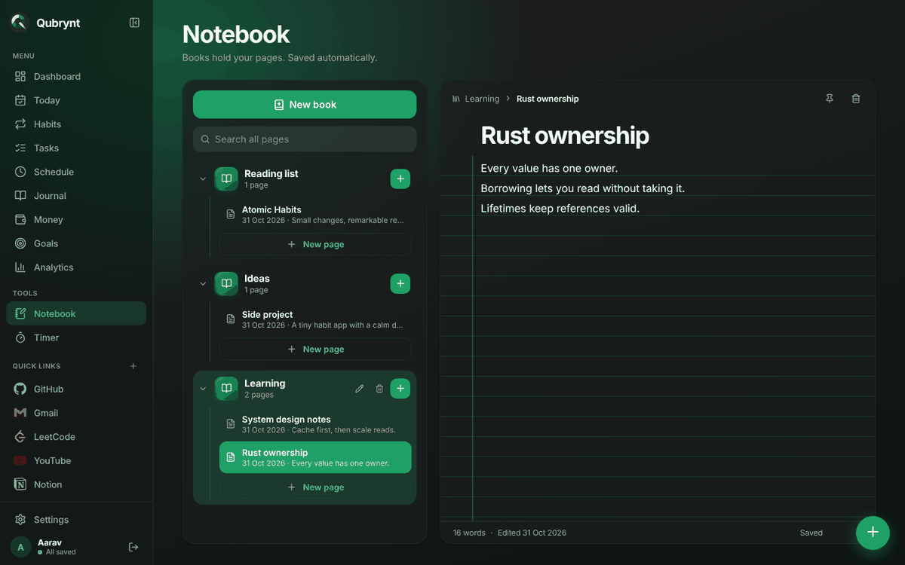
</p>

### Analytics
Week, month, 3 months, year or a custom range, with a written summary, trends, best and weakest days, habit consistency, money and mood. Export as CSV or print to PDF.

<p align="center">
  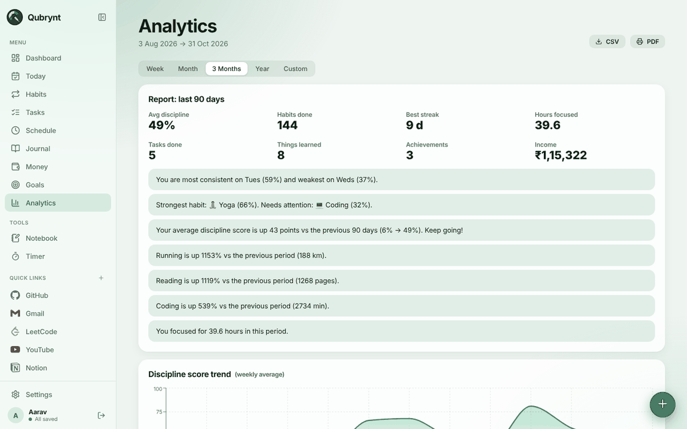
  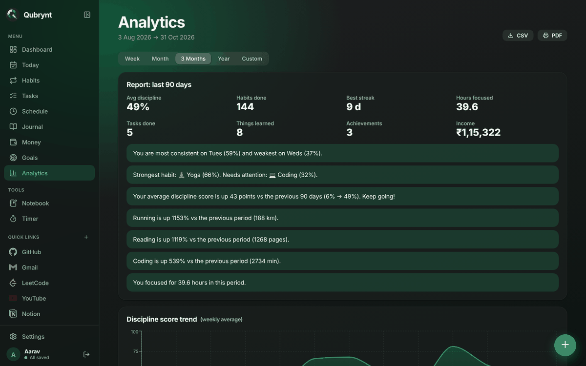
</p>

### Money
Track income and expenses in ₹ with categories you can edit, and see monthly totals and savings.

<p align="center">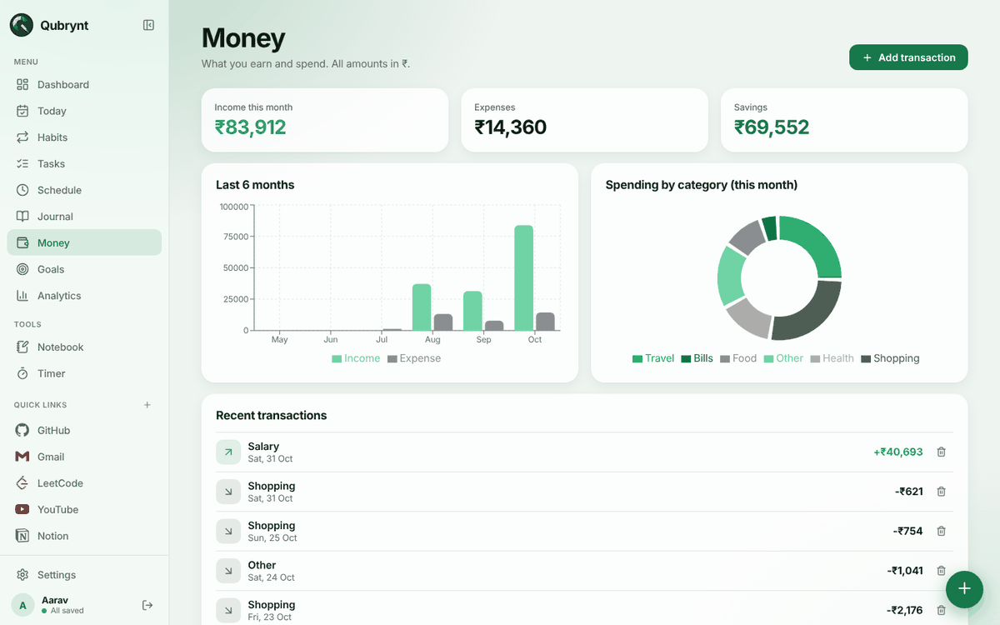</p>

### Journal, Goals and Schedule
<p align="center">
  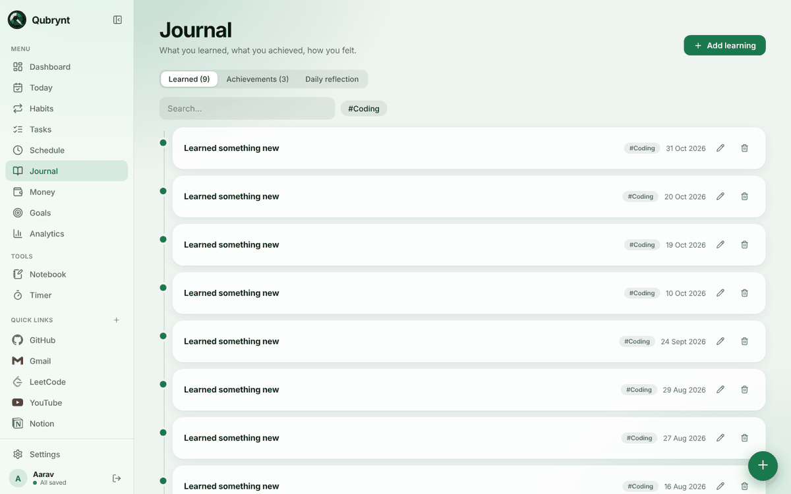
  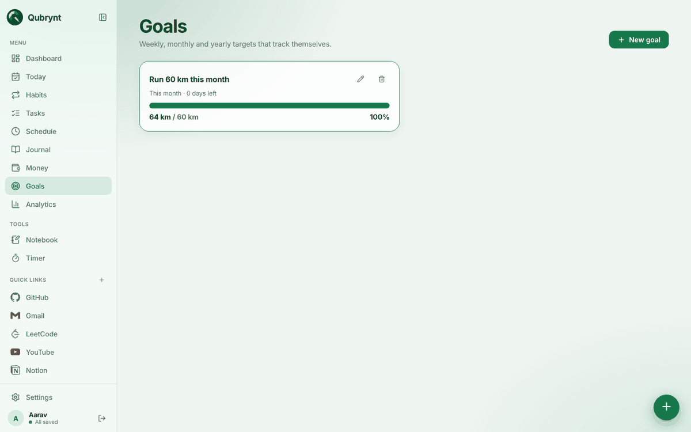
  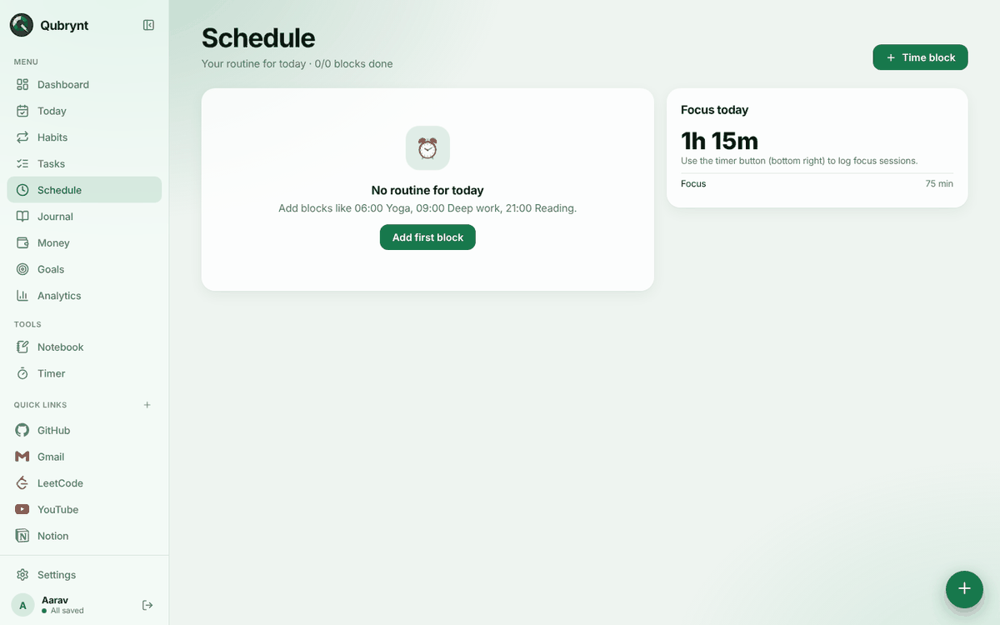
</p>

### Works on your phone
On small screens the sidebar becomes a tab bar with a **More** sheet.

<p align="center">
  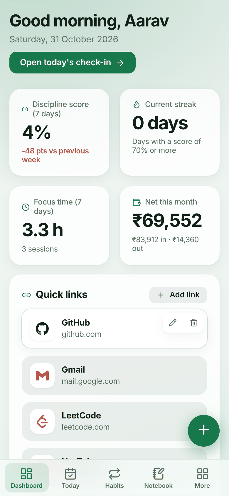
  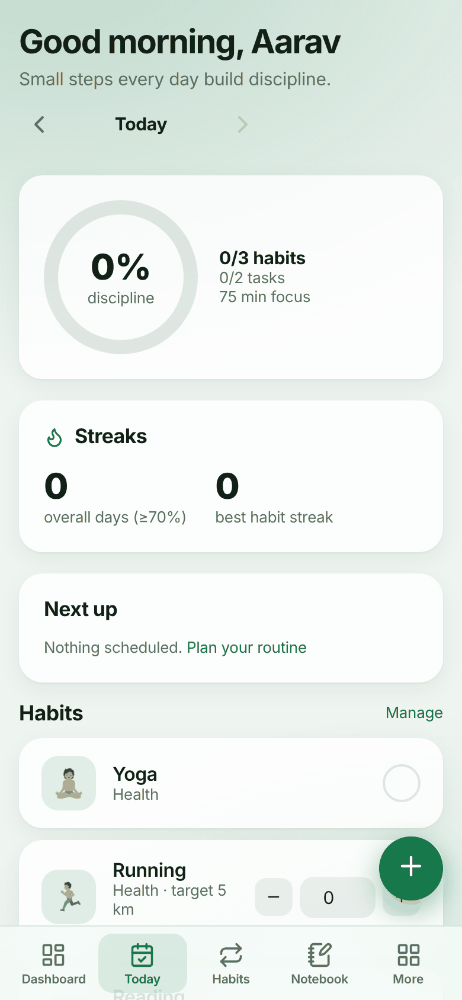
</p>

### Everything else
- Light and dark themes in a green palette
- Navigation on the left (collapsible to an icon rail) or as a bottom dock
- Quick links with real brand icons, and automatic icons for other sites
- Editable categories for activities, expenses and income in Settings
- Backup export and import, demo data to try the analytics, account deletion
- Keyboard shortcuts: press `g`, then a letter, to jump to a page (for example `g` `n` for the Notebook)
- Auto save with retry when you are offline

---

## For users: getting started
1. Open the app and choose **Sign up**.
2. Go to **Habits** and add two or three habits.
3. Each day, open **Today** and tick what you did.
4. Write what you learned in **Journal**.
5. After a week, open **Analytics**.

Want to see it with data first? Go to **Settings → Load demo data**, explore, then **Delete tracking data** when you are ready to start for real.

---

## For developers

### Tech stack
| Area | Tools |
|---|---|
| UI | React 18, TypeScript, Vite 5 |
| Routing and motion | react-router-dom, Framer Motion |
| Charts and icons | Recharts, lucide-react, simple-icons |
| Backend | Node.js, Express, MongoDB (see the backend repo) |

### How it fits together
```
Browser (this repo)  --HTTPS-->  Express API (backend repo)  -->  MongoDB
  React + Vite                    JWT auth, validation              one document per item,
  Vercel                          Render / Railway                  always scoped to a user
                                                                    MongoDB Atlas
```
- The app keeps all data in memory and updates the screen instantly. Every change is turned into a small operation (add, update or delete) and sent to the API in batches, with retry if the connection drops.
- On login the app loads everything with one request, so pages open instantly.

### Code structure
```
frontend/
├── index.html
├── vite.config.ts          dev proxy: /api -> http://localhost:5000
├── vercel.json             rewrites every path to index.html (SPA routing)
├── public/                 logo, favicon, app icons
├── scripts/
│   ├── make-brands.mjs     builds the brand icon list from simple-icons
│   └── make-logo.mjs       generates the Q logo
└── src/
    ├── main.tsx            entry point
    ├── App.tsx             layout, routes, navigation mode, shortcuts
    ├── api.ts              API client (token, base URL, 401 handling)
    ├── auth.tsx            sign in, sign up, session
    ├── store.tsx           app state and the save queue
    ├── sync.ts             diff and batched, retrying sync
    ├── types.ts            shared types
    ├── utils.ts            dates, scoring, chart colours
    ├── styles.css          theme tokens and layout
    ├── pages/
    │   ├── Dashboard.tsx   Today.tsx    Habits.tsx   Tasks.tsx
    │   ├── Schedule.tsx    Journal.tsx  Money.tsx    Goals.tsx
    │   ├── Analytics.tsx   Notebook.tsx Settings.tsx Auth.tsx
    └── components/
        ├── Sidebar.tsx  Dock.tsx  MobileNav.tsx  nav.ts
        ├── Timer.tsx    QuickAdd.tsx  LinkEditor.tsx
        ├── icons.tsx    brands.ts (generated)  Logo.tsx
        └── ui.tsx       Modal, Empty, PageHead, Ring, Confetti
```

### Run locally
You need Node 18.18 or newer and a running backend (see the backend README).

```bash
git clone https://github.com/quickbuildsdev/qubrynt_frontend.git
cd qubrynt_frontend
npm install
npm run dev          # http://localhost:5173
```
In development, `/api` is proxied to `http://localhost:5000`, so no setup is needed. To use another backend: `API_TARGET=http://localhost:6000 npm run dev`.

| Command | What it does |
|---|---|
| `npm run dev` | Dev server with hot reload |
| `npm run build` | Type check and production build into `dist/` |
| `npm run preview` | Serve the production build locally |

### Environment
| Variable       | Description |
|---             |---          |
| `VITE_API_URL` | Full backend API URL, for example `https://your-backend.onrender.com/api`.Leave unset in development. |

It is read at build time, so redeploy after changing it. `VITE_` variables are public, so never put secrets in them.

### Deploy
1. Push this folder to its own GitHub repo.
2. In Vercel choose **Add New → Project** and import the repo (build `npm run build`, output `dist`).
3. Add `VITE_API_URL` = `https://<your-backend>/api`, then deploy.
4. Set your Vercel URL as `CLIENT_ORIGIN` on the backend and redeploy it.

### Troubleshooting
- **CORS error:** `CLIENT_ORIGIN` on the backend must match this site's URL exactly, with no trailing slash.
- **404 on `/api/...` in production:** `VITE_API_URL` is missing or wrong. Fix it and redeploy.
- **404 when refreshing a page:** make sure `vercel.json` is committed.
